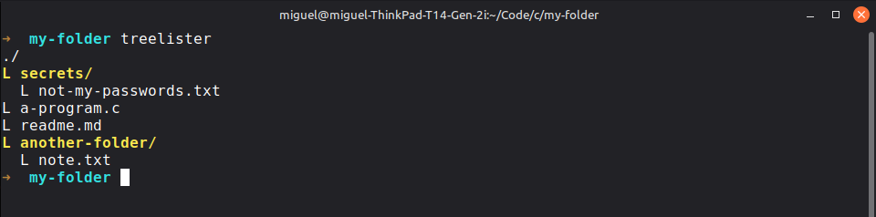

# a recursive directory viewer



hand written in C by miglito as study practice.

inspired by the simple design proposed by Hayyoth (https://hayyoth.org/)
in the first 78 seconds of this video -> https://www.youtube.com/watch?v=tiMHtc6l7xM
``` markdown
    - get user
    - walk(path)
        - if is directory, walk() it with recurssion
        - if is file, print name
```

## material I used:
- https://man7.org/linux/man-pages/man0/dirent.h.0p.html
- https://man7.org/linux/man-pages/man3/closedir.3p.html
- https://www.ibm.com/docs/en/zos/3.1.0?topic=functions-opendir-open-directory
- https://www.ibm.com/docs/en/zos/3.1.0?topic=functions-readdir-read-entry-from-directory